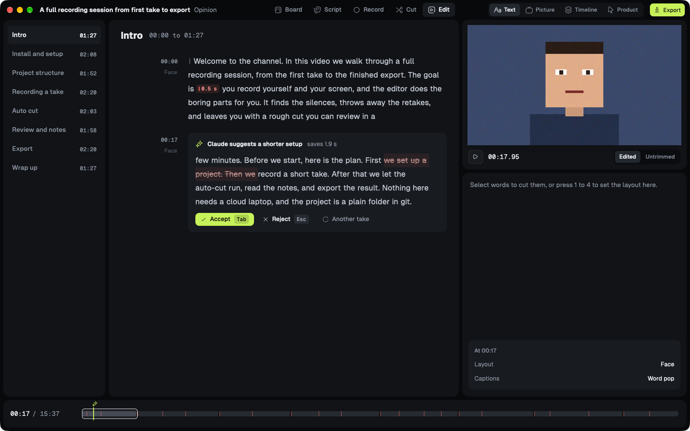
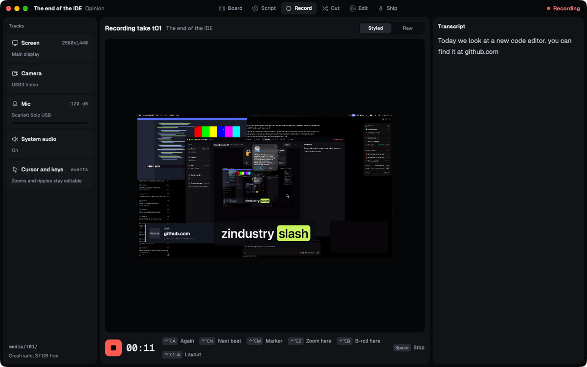
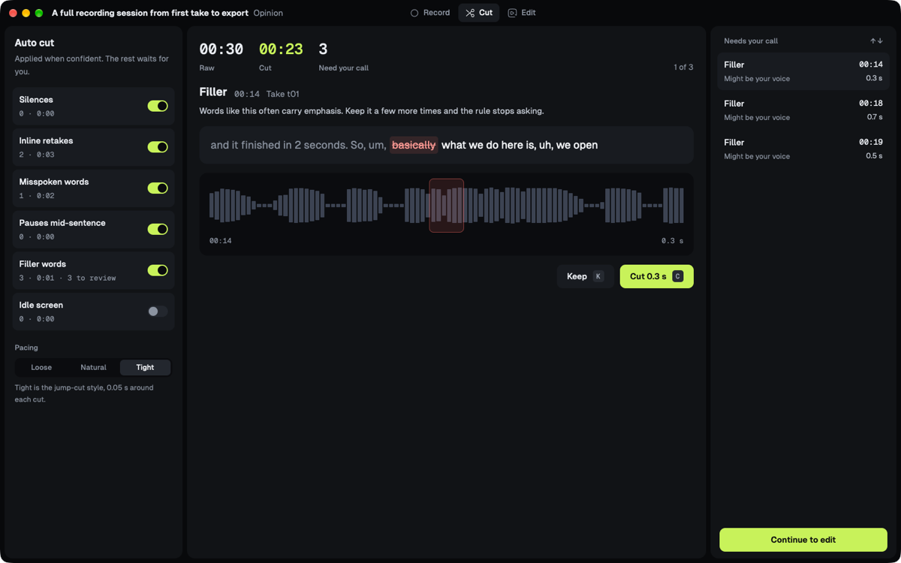
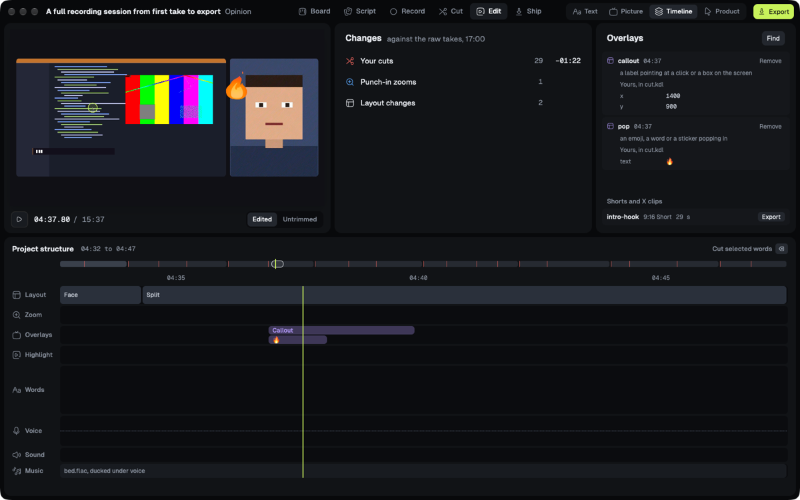
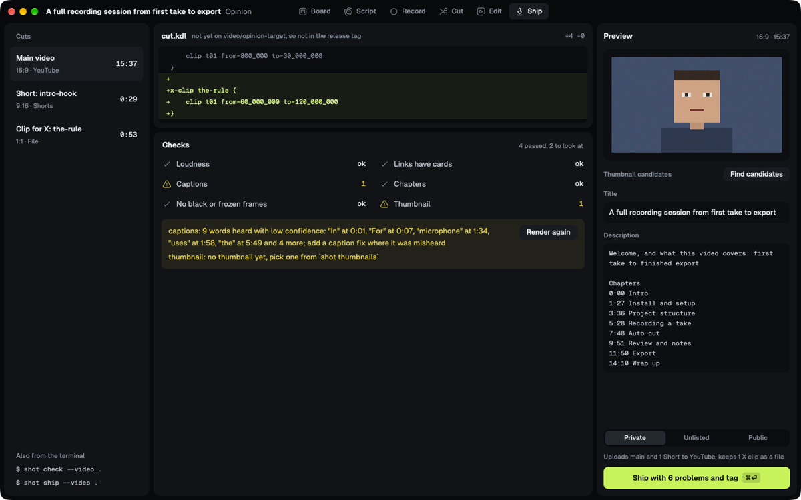
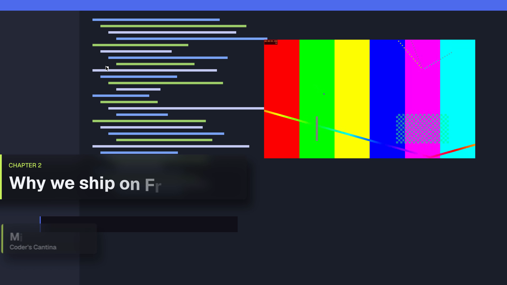

<div align="center">

# Shot Studio

**Record what you mean, style how it looks.**

A native macOS app for recording and editing developer videos: reactions, opinions, product tours and tutorials. The rough cut is ready when you press stop, the edit is a text file in git, and a rebrand is one rule instead of a hundred clicks. Written in Rust with gpui. Everything runs on your Mac.

[](LICENSE)
[](docs/README.md)
[](#build-from-source)
[](https://github.com/coderscantina/shot-studio/actions/workflows/ci.yml)

[How it works](#how-it-works) · [Build from source](#build-from-source) · [Contributing](CONTRIBUTING.md) · [Design docs](docs/README.md)



</div>

> [!NOTE]
> Shot Studio is in development and has no release yet. Most of the first release is built and measured, the numbers below come from the [evidence reports](docs/evidence/). The YouTube upload and the Elgato Prompter have not been tested end to end yet.

## Why Shot Studio

- **You style the video, you don't assemble it.** Zooms, cards, cuts, sounds and transitions are rules over what the recording means: the words you said, the clicks, the URLs, the silences, your markers. Change the pacing or the channel accent and every video re-cuts itself. You fix the exceptions instead of placing every instance by hand.
- **The rough cut is ready when you press stop.** Transcription and analysis run while you record, so there is no processing step. A 42 s take had its chapter in the edit 2.3 s after stop.
- **The edit is a plain text file in git.** `cut.kdl` holds what you keep, layouts and overrides. You can read it in a diff, an agent can edit it, and every change is reversible.
- **Exports are incremental builds.** A 17 min 4K60 video exports in under 10 minutes on an M1 Pro, faster than realtime. Delete one word and the re-export takes about 7 s, because only the two chunks that changed render again.

Claude does the judgement work: script drafts, unsure cuts, Shorts picks, misheard names. It goes through your local `claude` CLI, gets text only, and never sees raw audio or video. There is no telemetry and no API key in the app.

## Features

- **Board.** A Kanban board over a git repo, one folder and branch per video. Moving a card is a commit, a shipped video is a tag.
- **Script.** Write `script.md` with an agent that drafts hooks, tightens beats and fact checks. Suggestions arrive inline: Tab to accept, Esc to reject.
- **Record.** Screen, camera, mic, system audio and cursor events as separate tracks in fragmented MP4, so a crash loses at most the last fragment. The monitor shows the styled video while you record. Hotkeys for retakes, markers, zooms, b-roll and layouts, and a prompter that follows your voice.
- **Auto cut.** Silences, inline retakes, misspoken words, mid-sentence pauses, filler words and idle screen. Confident cuts apply right away, unsure ones wait in a review queue with Keep (K) and Cut (C). Pacing is Loose, Natural or Tight.
- **Edit by text.** Delete words to cut them. Select a phrase to add a zoom, a highlight or b-roll. Edited and Untrimmed show what the rules removed.
- **Effects as styles.** Punch-in zooms, click zooms and ripples, link cards for URLs you say, callouts, emoji pops, captions with word timing, code typed out from a real git diff, chapter bands, intros, outros and end cards. Four motion presets (reactive, editorial, launch, calm) with springs, glass and kinetic type, and Lottie for brand animations.
- **Brand and formats.** One `brand.kdl` sets fonts, colors, logo and sounds for the channel. Formats and single videos override only what differs. Every instance shows which rule made it.
- **Audio.** Denoise, EQ, compressor, music that ducks under your voice, and export at -14 LUFS. With music and 470 click sounds in, the reel measured -14.2 LUFS.
- **Shorts and X clips.** Derived cuts are a few lines in `cut.kdl`, reframed on your face, and reuse the rendered segments of the main video.
- **Ship.** `shot check` tests loudness, captions, black or frozen frames, links, chapters and the thumbnail, and stays quiet when everything passes. `shot ship` uploads the main video and Shorts to YouTube and tags the release.
- **CLI and MCP.** The app, the `shot` CLI and the `shot` MCP server share one core. Anything you click, a script or an agent can do too.

<table>
  <tr>
    <td width="50%">
      
    </td>
    <td width="50%">
      
    </td>
  </tr>
  <tr>
    <td width="50%">
      
    </td>
    <td width="50%">
      
    </td>
  </tr>
</table>



## How it works

Shot Studio treats a video like a software project. If you write code, you already know the workflow.

| Habit | In Shot Studio |
| --- | --- |
| Issue board | A Kanban board over a git repo. Each card is a video folder and a branch |
| Spec | `script.md`: chapters as headings, beats as bullets |
| Linter with auto-fix | Auto cut: confident cuts applied, unsure ones queued |
| Source code | `cut.kdl`, readable in a diff and by an agent |
| Stylesheet and lockfile | The brand, format and video style cascade, and `cut.lock` listing what each rule produced |
| PR review | The review queue, plus agent proposals you merge or reject like branches |
| Branches | Derived cuts: main video, Shorts, X clip |
| `cargo build` | Render from cached segments, `shot build --watch` on every save |
| CI | `shot check` |
| Release | `shot ship`: upload, chapters, description, git tag |

A recording becomes a list of elements: words, silences, fillers, clicks, typing, URLs said, faces, markers. Style rules match those elements, the way CSS matches HTML:

```kdl
// formats/opinion.kdl
pacing tight
on silence min=600_000 {
    cut breath=50_000 confidence=85
}
on emphasis {
    zoom 112
}
on click {
    zoom 160 hold=1_500_000
}
```

`cut.kdl` keeps what only you can decide, plus overrides for single moments:

```kdl
chapter "Hook" {
    take t01 {
        keep from=0 to=12_000_000
    }
}

override t01 click at=6_200_000 {
    zoom off
}

short friday-deploys {
    clip t01 from=5_100_000 to=12_000_000
}
```

Evaluating 17 minutes of a dense take, 5,882 elements against 11 rules, takes 3.7 ms. Every build writes `cut.lock`, so a style change shows up as a diff, and segments are cached by content. Changing the channel accent re-rendered 212 of 1,915 chunks, only where something branded draws. Shipped videos stay pinned at their tag until you run `shot restyle`.

Under the hood: VideoToolbox decode straight into a Metal texture for the preview, one wgpu render graph for preview and export, vello and parley for overlays, whisper large-v3-turbo with Metal for transcription, and hardware encoding with stream-copy joins.

## Who it's for

Developers who publish on a schedule and record the same few formats again and again. The first user is the Coder's Cantina channel, and it ships with four formats: reaction, opinion, product tour and tutorial.

It is not a general video editor. There are no free-form tracks, no color grading and no keyframes on every property. If you cut a wedding film or a music video, use DaVinci Resolve. If you record a talking head over a screen every week and want the boring parts done for you, this is built for you.

## Install

There is no release yet. The first one will be a signed and notarized DMG on [GitHub Releases](https://github.com/coderscantina/shot-studio/releases) and a Homebrew cask, for macOS 26 or newer on Apple Silicon:

```sh
brew install --cask coderscantina/tap/shot-studio
```

The cask also puts the `shot` command on your `PATH`.

## Build from source

You need macOS 26 or newer on Apple Silicon, and a current stable Rust toolchain from `rustup`.

```sh
git clone https://github.com/coderscantina/shot-studio.git
cd shot-studio
cargo build --release
```

Open a video folder in the app, and drive the same folder from the CLI:

```sh
./target/release/shot-app <video-folder>
./target/release/shot record --video <video-folder>
./target/release/shot autocut --video <video-folder>
./target/release/shot export --video <video-folder>
```

`./target/release/shot --help` lists every command. To try it without recording, `scripts/fixtures.sh all` generates a 17 min 4K60 test project with ffmpeg, see [fixtures/README.md](fixtures/README.md). Recording needs Screen Recording, Camera and Microphone access. The speech model, about 1.6 GB, downloads on first use and is checked against a pinned SHA-256.

`scripts/bundle.sh` builds `Shot Studio.app` and a DMG into `dist/`.

## Contributing

Bug reports and pull requests are welcome. Start with the [contributing guide](CONTRIBUTING.md). It covers the build, the gitmoji commit format and the checks CI runs. The [development docs](docs/README.md) hold the technical briefing, the decisions and the evidence behind every feature.

- [GitHub Issues](https://github.com/coderscantina/shot-studio/issues/new/choose) for bugs and feature requests

Please report vulnerabilities privately, as described in the [security policy](SECURITY.md).

## License

Shot Studio is licensed under the [MIT license](LICENSE). Bundled fonts, sounds, emoji, libraries and crates keep their own licenses, listed in [THIRD-PARTY-LICENSES.md](THIRD-PARTY-LICENSES.md) and the app's About window.

## Acknowledgements

- The [Zed](https://zed.dev) team for gpui, and the [gpui-component](https://github.com/longbridge/gpui-component) authors
- The [Linebender](https://linebender.org) projects vello, parley and velato
- [whisper.cpp](https://github.com/ggml-org/whisper.cpp) and OpenAI's Whisper models
- The people behind the Rust libraries Shot Studio is built on

---

<div align="center">
  <p>Maintained by <a href="https://github.com/badmike">badmike</a></p>
</div>
